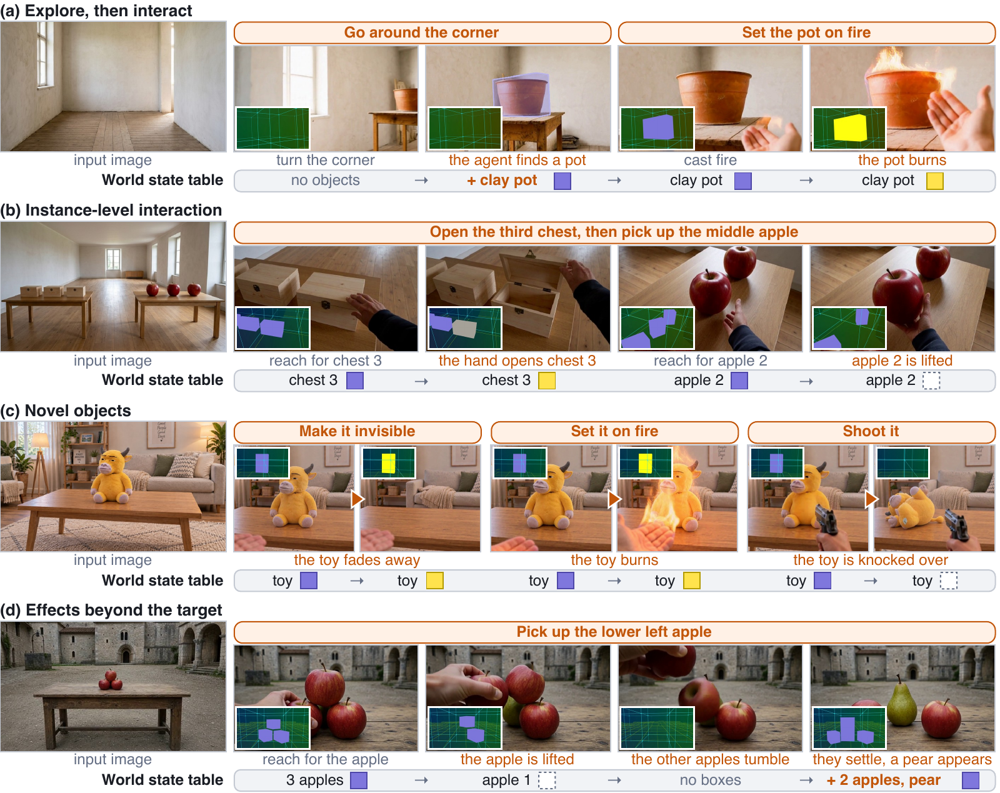

<h1 align="center">
  &nbsp;Oneira
</h1>

<p align="center"><b>From Open-Ended Generation to Open-World Interaction in Video World Models</b></p>

<div align="center">

[](https://madaoer.github.io/projects/oneira/)
[](https://madaoer.github.io/projects/oneira/assets/oneira.pdf)
[](https://arxiv.org/abs/2610.01614)

</div>

> #### [Oneira: From Open-Ended Generation to Open-World Interaction in Video World Models](https://arxiv.org/abs/2610.01614)
>
> ##### [Xindi Yang](https://madaoer.github.io/), [Baolu Li](https://libaolu312.github.io/), [Liam Lee](https://madaoer.github.io/projects/oneira/#), [Zhenfei Yin](https://yinzhenfei.github.io/), [Songxin Zhang](https://madaoer.github.io/projects/oneira/#), [Zhuoyang Song](https://madaoer.github.io/projects/oneira/#), [Xu Jia](https://stephenjia.github.io/), [Jianfei Cai](https://jianfei-cai.github.io/), [Tien-Tsin Wong](https://ttwong12.github.io/), [Bingyi Jing](https://scholar.google.com/citations?user=k83Zz2MAAAAJ&hl=en), [Mengyue Yang](https://ymy4323460.github.io/)&dagger;  (&dagger; corresponding author)

<p align="center">
  
</p>

Oneira is an interactive video world model built around an explicit world state that a coding agent manages. The agent adds objects that appear during exploration to a world state table and writes the outcome of every interaction into it. An engine renders the updated table into a conditioning video, and the video model generates the next segment from it. As a result, **newly generated objects become interactive**, and **their changed states persist over long horizons**.

Code is still under preparation. All code will be available later.

## Citation

```bibtex
@misc{yang2026oneira,
  title={Oneira: From Open-Ended Generation to Open-World Interaction in Video World Models},
  author={Xindi Yang and Baolu Li and Liam Lee and Zhenfei Yin and Songxin Zhang and Zhuoyang Song and Xu Jia and Jianfei Cai and Tien-Tsin Wong and Bingyi Jing and Mengyue Yang},
  year={2026},
  eprint={2610.01614},
  archivePrefix={arXiv},
  primaryClass={cs.CV},
  url={https://arxiv.org/abs/2610.01614},
}
```
